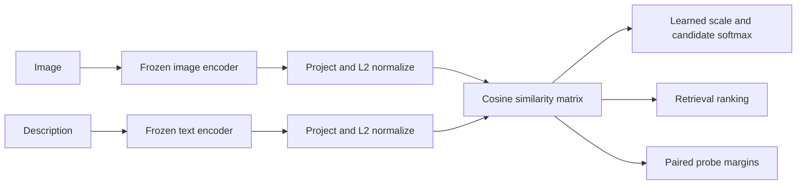

# CLIP Explorer: 45-minute graduate presentation

Companion to Radford et al., *Learning Transferable Visual Models From Natural Language Supervision*, ICML 2021. Sources: [paper](https://arxiv.org/abs/2103.00020), [official implementation](https://github.com/openai/CLIP).

| Minutes | Topic | Visual / classroom prompt |
|---|---|---|
| 0–5 | Motivation: fixed categories vs natural language supervision; noisy descriptions at scale | Ask students what changes when a classification vocabulary changes. Natural language is supervision, even without fixed human-assigned class IDs. |
| 5–11 | Dual image/text encoders and linear projections into a shared space | Show the two CLIP Process Walkthrough architecture diagrams, then rotate the 3D Embedding Space view. Explain normalization and cosine geometry; encoders have different inputs but matching output dimensions. The plot is a joint, lossy projection, not the original 512D geometry. |
| 11–19 | In-batch negatives, symmetric cross-entropy, learned temperature | Use the visual Training cycle to inspect both softmax directions, per-positive losses, symmetric CE, and gradients; play the actual toy optimization animation. Then use the Contrastive lab for real scores and rotated captions. No model training occurs in the demo. |
| 19–25 | Zero-shot classifier construction from class descriptions | Use the visual Testing cycle to trace real preprocessing, BPE tokens, embeddings, scores, prediction, and labeled evaluation. In the zero-shot lab, add/remove a category to distinguish similarity, logits, and candidate-dependent softmax. |
| 25–31 | Prompt sensitivity and normalized embedding ensembles | Prompt lab: same labels/images for raw names, contextual prompt, and ensemble; show the averaging order. |
| 31–34 | Natural-language and image retrieval | Retrieval lab: change a query and K; ordinary cosine ranking, no vector database. |
| 34–40 | Compositional probes and interpretation | Failure lab: known counts/relations/bindings, measured paired margins, counterbalanced alternatives, limitations of correlated drawings. |
| 40–45 | Generalization, dataset shifts, limitations, discussion | Separate useful transfer from universal understanding; discuss candidate choice, preprocessing, dataset bias, calibration, and what a stronger evaluation would require. |

During pretraining the two encoders and logit scale are learned jointly. During this application all parameters are frozen. The contrastive lab computes an illustrative training objective on a small batch; it does not update the encoders.

For normalized vectors, `S_ij = v_iᵀu_j`. Let `L = exp(α)S`. For aligned batches, `y = [0,…,N−1]`; the symmetric loss is the average of row cross-entropy and transposed-column cross-entropy. If captions are permuted, image targets follow the permutation and text targets use the inverse. Lower temperature sharpens distributions but magnifies wrong rankings too.

For zero-shot classification, a class description produces a classifier vector. `argmax cosine(v,u_c)` selects a candidate; softmax rescales relative scores into a distribution over that supplied set. It cannot establish that the image belongs to one of those classes. Discuss the distinction between “unseen dataset” transfer in the paper and asserting that a concept never appeared in pretraining.

For ensembling, normalize each template embedding, average embeddings for each class, normalize the mean, and score. A single best phrasing or higher accuracy on 17 curated photographs is not evidence of general prompt optimality.

For probes, hold alternative captions fixed and inspect `cos(correct)−cos(distractor)`. A positive result means the correct alternative wins this pair, not that the model understands every related scene. A negative result is a measured error on this probe. Propose richer photographs, unseen renderers, more caption templates, and independent data for follow-up evaluation.

Discussion questions:

1. Why are some off-diagonal pairs legitimate semantic matches despite being treated as training negatives?
2. What is lost by comparing two captions rather than a full candidate set?
3. Why can removing the true class produce a high-probability incorrect answer?
4. What nuisance factors should a spatial or counting benchmark control?
5. What would you need to claim an ensemble reliably improves generalization?

The app uses ViT-B/32 for classroom latency. The paper evaluates multiple architectures; do not attribute its larger-model benchmark results to this checkpoint or the local drawings. Use [DEMO.md](DEMO.md) when compressing the interactive portion to 12 minutes.
