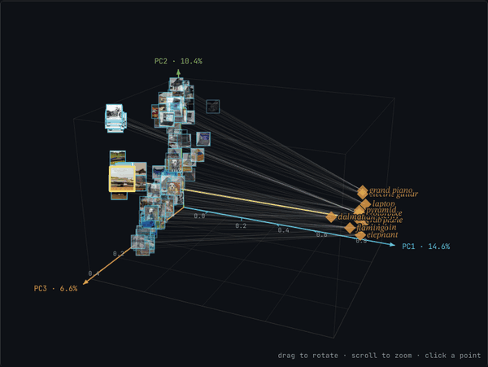
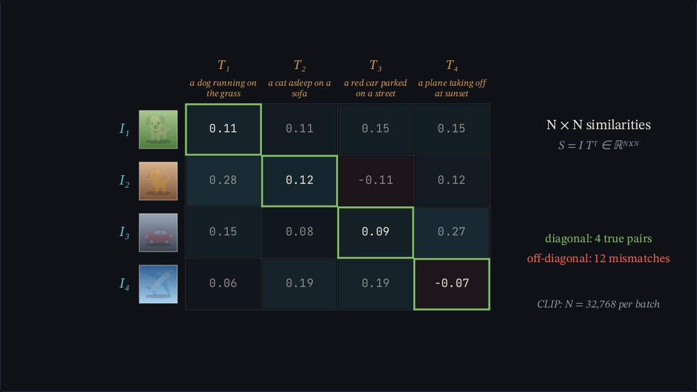
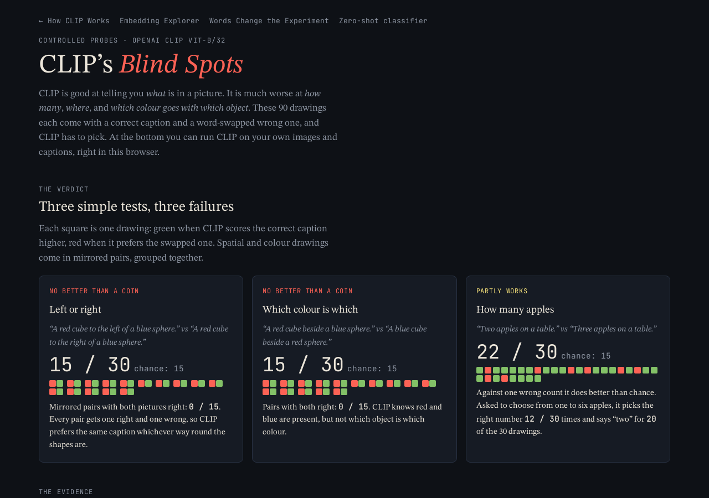
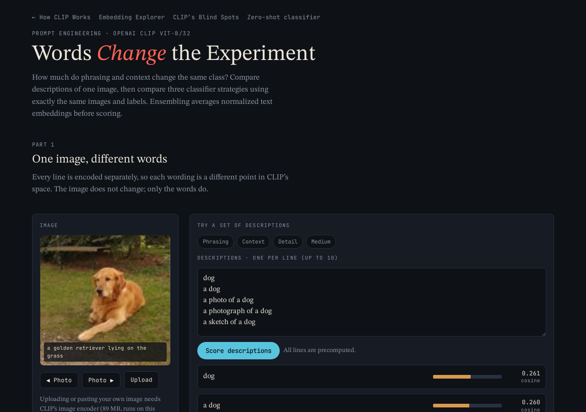

# How CLIP Works

[](media/demo_pca_spin.mp4)

*Real CLIP embeddings for Caltech-101 photos and their class captions, projected to 3D with PCA. Recorded from the Embedding Explorer page. Click for the MP4.*

A visual, browser-only guide to the CLIP paper, [Learning Transferable Visual Models From Natural Language Supervision](https://arxiv.org/abs/2103.00020) (Radford et al., 2021). It's plain HTML and JavaScript with no build step and no server code. OpenAI's ViT-B/32 CLIP model runs right in the browser, so you can try your own images and captions.

**Live version:** [How CLIP Works on Claude](https://claude.ai/artifact/7JbXUPpy1CNJeg2tU9RNUP)

The original Streamlit app (Python labs, activation inspectors, tests) lives on the [`streamlit`](../../tree/streamlit) branch.

## Demo pages

### How CLIP Works (`index.html`)
Nine short animated scenes that build CLIP up from pixels to zero-shot classification: patches and tokens, the two encoders, the shared space, the batch similarity matrix, the contrastive loss, training, and prediction. Each scene shows its equations and ViT-B/32 tensor shapes.



### Embedding Explorer (`demo.html`)
Real CLIP vectors for 38 photos with captions, or 12 Caltech-101 classes, squeezed to 2D or 3D with PCA or t-SNE in the browser. Rotate, zoom, and click any point to see what CLIP ranks as closest in the full 512D space. There's also a toggle to remove the gap between image and text vectors. The video at the top is this page.

### CLIP's Blind Spots (`failures.html`)
90 drawings, each with a correct caption and a word-swapped wrong one. CLIP does about as well as a coin flip on left vs right and on which colour goes with which object, and only partly works on counting. You can also run CLIP on your own images and captions at the bottom.



### Words Change the Experiment (`prompts.html`)
How much does wording matter? Compare many descriptions of one image, then compare three classifier strategies (raw class names, a contextual template, and an ensemble of templates) on the same images and labels.



### Build a Classifier with Words (`zeroshot.html`)
Upload up to 8 images, type 2 to 20 class names, and CLIP ranks them. The class list is the classifier. Presets include dog breeds, scenes and moods, and a set where the right answer is missing.


## Run it locally

The model files are loaded with `fetch`, so open the pages through a local web server rather than straight from disk:

```bash
python3 -m http.server 8000
```

Then go to http://localhost:8000. Any static host (GitHub Pages, Netlify, etc.) works the same way.

## What's in the repo

```text
index.html        Animated walkthrough
demo.html         Embedding Explorer (PCA / t-SNE, 2D / 3D)
failures.html     Blind spots: counting, spatial relations, colour binding
prompts.html      Prompt wording and ensembling
zeroshot.html     Zero-shot classifier with your own images and classes
data/             Precomputed CLIP embeddings and image atlases
model/            CLIP ViT-B/32 weights for the browser, int8, split into chunks
media/            README video and screenshots
```

The pages only reach out to Google Fonts. The browser model uses int8 weights, so scores can differ slightly from the full-precision PyTorch model.

## Credits

- [CLIP paper](https://arxiv.org/abs/2103.00020) and [OpenAI CLIP code](https://github.com/openai/CLIP)
- Photos from Wikimedia Commons and scikit-image, plus a subset of [Caltech-101](https://data.caltech.edu/records/mzrjq-6wc02). Photo credits are shown on the pages; full credits and licenses are on the `streamlit` branch in `assets/`.
